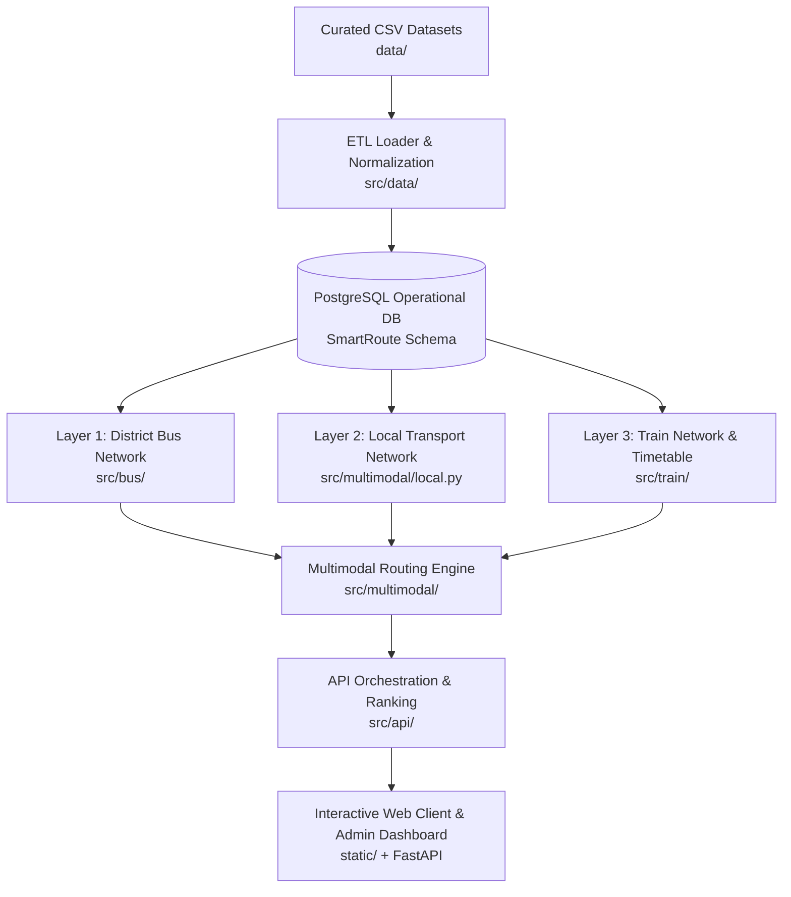

# SmartRoute BD — Project Pipeline & Architecture

## 1. System Pipeline Overview

SmartRoute BD is a database-driven, district-aware, schedule-aware multimodal transport route planner for Bangladesh. The pipeline is structured across five major tiers:

## 2. Layers & Calculations

### Layer 1: District Bus Network (`src/bus/`)
- **Graph:** Undirected weighted graph of inter-district road distances (`64_districts.csv`).
- **Dijkstra Shortest Path:** Uses deterministic canonical alphabetical ordering `(start, end)` to strictly guarantee forward and reverse route consistency (e.g., Dhaka ➔ Cumilla and Cumilla ➔ Dhaka have identical distances, paths, core city counts, and fares).
- **Bus Fare:** `Bus Fare = 50 + (50 × core_city_count) + (2 × total_distance_km)` with Half-Up rounding.
- **Traffic Time Estimation:** Configured factors for all 24 hours of the day (e.g., 0.7 for peak hours 08:00–10:00 & 17:00–20:00, 1.2 for night 22:00–06:00, 1.0 off-peak) and major city multipliers (0.9 for 1, 0.8 for 2, 0.7 for ≥3). Estimated travel time range: `[0.85×, 1.0×, 1.2×]`.

### Layer 2: Local Transport Network (`src/multimodal/local.py`)
- Source: `data/local_distance.csv`.
- Flat fare: 50 BDT per local leg.
- Speed: 30 km/h (`travel_time = distance / 30 × 60` minutes).
- Resolves upazilas to parent districts and last-mile railway station connections.

### Layer 3: Train Network (`src/train/`)
- Sources: `data/train_routes_final.csv`, `data/train_stops.csv`.
- Validates ordered station stops, train service directions, and off-days.
- **Train Fare:** `Train Fare = 40 + (1.5 × distance_km) + (60 if intermediate_stops ≤ 2 else 0)` with Half-Up rounding.
- Handles overnight day offsets and schedule waiting times.

### Multimodal Combiner (`src/multimodal/`)
- Destination-oriented interchanges only.
- Strict limit of 1 main-mode transfer (Bus ➔ Train or Train ➔ Bus).
- Buffer rules: 30 minutes for train/bus transfers, 15 minutes for local legs.
- Cycle/detour prevention rejecting any loops.

### API & Comparison Engine (`src/api/`)
- Compares valid routes across three independent metrics:
  - **Cheapest:** Minimum total fare (BDT).
  - **Fastest:** Minimum expected journey duration (travel + waiting minutes).
  - **Shortest:** Minimum total distance (km).
- Generates dynamic, data-driven comparison insights.
